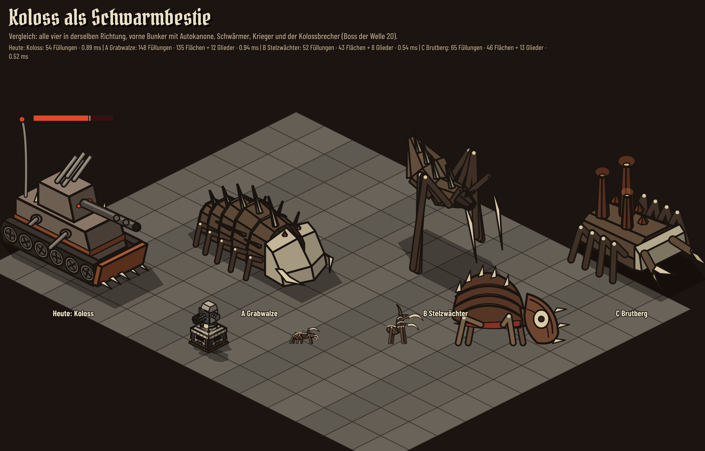
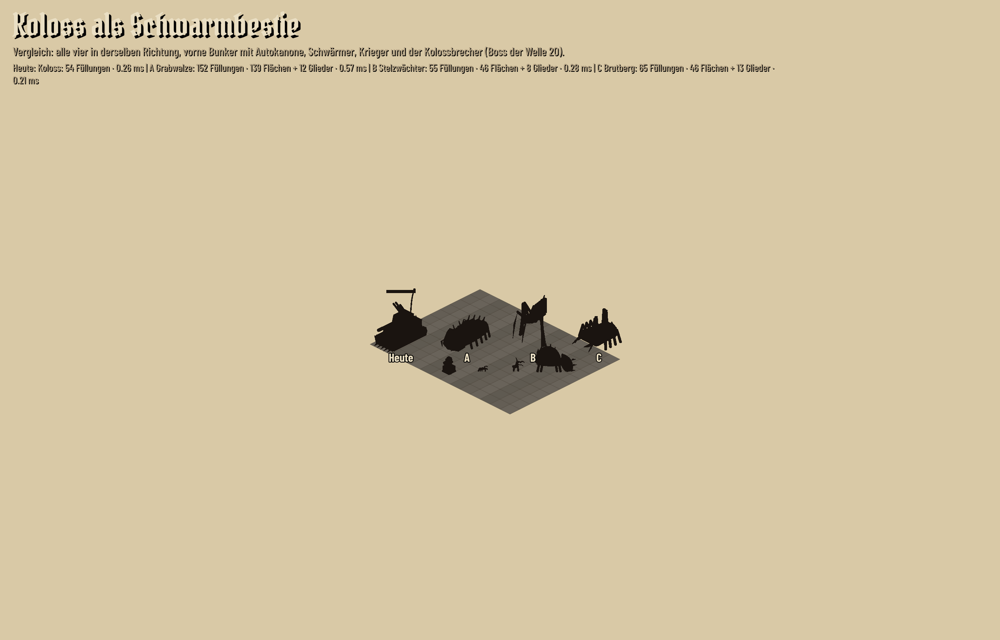

# Koloss als Schwarmbestie (Studie, Issue #75, Aufgabe A-39)

Tills Wunsch vom 04.11.2026: Der Koloss (Welle 35 und 45) passt als gepanzerte Kriegsmaschine
nicht zu Wellen aus insektoiden Schwarmmonstern. Gesucht ist ein anderes Aussehen, **die Regeln
bleiben, wie sie sind** (GDD, „Späte Bedrohung: der Koloss“).

Studie: `reference/studien/koloss-schwarm.html` (dazu `koloss-schwarm.js` und das Modell-Modul
`koloss-schwarm-modell.js`). Start: `python3 -m http.server 8000` im Projektordner, dann
<http://localhost:8000/reference/studien/koloss-schwarm.html>. Der heutige Koloss wird dort vom
Spielcode selbst gezeichnet (`src/render/koloss.js`, unverändert), Bunker, Gegner und Trümmer
ebenfalls aus `src/render/`. `src/` ist nicht verändert.

Schalter: Modell (Heute, A, B, C) oder **Vergleich** (alle vier nebeneinander, vorne Bunker mit
Autokanone, Schwärmer, Krieger und der Kolossbrecher, Boss der Welle 20), **Richtung** (Fahrt oder
fest +x, +y, −x, −y), **Zoom** (0,4 / 1 / 2,5, die Grenzen des Spiels), **Tempo** (1x, 2x, 3x, 8x),
**Silhouette** (alles Stehende als Tuscheschatten auf hellem Papier, harter Schwellwert, Schatten
und Leuchten fallen weg), **Treffer** (Aufblitzen alle 1,4 s), **Pause**.

In der Fahrt läuft das Modell eine Runde: fünf Felder Schneise durch Trümmer (rot markiert wie die
Zielvorhersage), dann vier Drehungen auf der Stelle zu je 0,6 s (`KOLOSS_RUN.turnSeconds`) mit
`KOLOSS.speed` 0,35 Feldern je Sekunde. Trümmer der Schneise brechen und fliegen zu beiden Seiten
weg, die Trümmer daneben bleiben stehen. Tempo und Drehzeit kommen aus `src/data/enemies.js`.

Standbilder (deviceScaleFactor 2, danach mit PIL auf 256 Farben verkleinert) schreibt
`node tests/tools/koloss-schwarm.mjs`; das Skript prüft dabei auf Konsolenfehler und gibt die
Zahlen unten aus.

## Die Entwürfe

| | |
|---|---|
|  |  |

**A Grabwalze** (`walze-*.png`). Ein langer, flacher Segmentkriecher: fünf gewölbte Panzerschalen
mit Knochenrand, die wie Schindeln übereinanderliegen, eine Stachelreihe auf dem Rücken, vorne ein
Pflugschädel aus Knochen, der als Keil die Trümmer zu beiden Seiten teilt, daneben zwei
Mandibeln. Fünf kurze Beinpaare laufen in einer Welle vom Kopf nach hinten; beim Drehen auf der
Stelle führt der Schädel, und die Segmente folgen nacheinander, alle innerhalb der 0,6 s.

**B Stelzwächter** (`stelze-*.png`). Ein Leib hoch auf sechs langen Beinen, die Knie über dem
Rücken, der Hinterleib hebt sich wie eine Haube. Zwei Sicheln rechen den Boden vor ihm frei und
schlagen beim Durchbruch schneller; Dreibeingang.

**C Brutberg** (`brut-*.png`). Ein breiter, flacher Krabbenleib, der die Brut trägt: drei Schlote
aus Fleisch mit glimmenden Mündungen, Säcke an ihrem Fuß, vorne ein Knochenrand und zwei Scheren
als Pflug, die beim Durchbruch schnappen. Vier dicke, gespreizte Beinpaare.

Allen gemeinsam: Palette und Formsprache der Brut aus `reference/konzept/gegner/` (dunkles Chitin,
Knochen, rotes Fleisch, orange Augen, Beine als Tuschestäbe mit Knochengelenken). Keine Waffen,
keine Antenne, keine Ketten. Eigenes Design, keiner bekannten Figur nachgebaut.

Abgrenzung zum Kolossbrecher (Welle 20, Kuppel mit Stacheln und Rammschild): A ist lang und flach
statt hoch und rund, B steht offen auf Stelzen, C trägt senkrechte Schlote. Auf Zoom 0,4 sind alle
drei als Schattenriss vom Boss der Welle 20 und von den übrigen Gegnern zu unterscheiden
(`silhouette-zoom-0-4.png`, `silhouette-zoom-1.png`); am klarsten A.

## Größe und Raster

**Was die Regeln belegen.** Die Simulation kennt keinen Fußabdruck: Der Koloss ist ein Punkt, der
von Feldmitte zu Feldmitte fährt (`src/sim/koloss.js`), die Schneise ist genau 1 Feld breit und
5 Felder lang, Nachbarfelder bleiben unberührt. Das heutige Modell wird mit dem Faktor 1,3
gezeichnet und ist etwa 3,8 Felder lang und 1,7 Felder breit (GDD: „optisch breiter als ein Feld,
etwa 1,7 Felder, gewollt“). Die Entwürfe halten diese Ordnung: Der Leib bleibt um 1,5 Felder breit,
nur Beine und Scheren reichen darüber hinaus.

| | Länge (Felder) | Breite Leib / mit Beinen (Felder) | Höhe Modell (px) | Bildhöhe +x / −x (px) | Bildbreite (px) |
|---|---|---|---|---|---|
| Heute: Koloss | 3,8 | 1,7 / – | 130 mit Antenne, 75 Turm | 155 / 135 | 170 |
| A Grabwalze | 4,0 | 1,5 / 2,3 | 50 Panzer, 76 Stacheln | 80 / 76 | 159 |
| B Stelzwächter | 2,9 | 1,1 / 2,2 | 80 Leib, 116 Haube | 141 / 124 | 108 |
| C Brutberg | 3,1 | 1,7 / 2,6 | 42 Panzer, 90 Schlote | 104 / 83 | 158 |

Bildhöhe: oberster deckender Bildpunkt über dem Fußpunkt bei Zoom 1, in Weltpixeln, gemessen mit
`__study.measure` (Schatten und Lebensbalken zählen nicht).

Zum Vergleich (Bildhöhe in Weltpixeln, aus den Sprites des Spiels): Schwärmer 20, Krieger 46,
Brecher 39, Bunkerdach 21, Bunker mit Autokanone 48, Bunker mit Tesla 70, Kolossbrecher (Boss 20)
93, Warp-Herold und Dämonenprinz 120, Seelenfeuer-Obelisk 130.

Damit ist A **niedriger als der Boss der Welle 20** und knapp eineinhalbmal so hoch wie ein Bunker
mit Waffe, wirkt groß aber durch Länge. B überragt alles außer dem Obelisken, C liegt dazwischen.

## Leistung

Je Bild, in der Fahrt gemessen (Füllungen und Konturen auf dem Canvas gezählt), dazu die Zeit für
eine Zeichnung im Mittel aus 600 (Chromium ohne Grafikkarte im Container, daher nur als
Verhältnis zu lesen):

| | Füllungen | Flächen + Glieder | ms je Zeichnung | gegen heute |
|---|---|---|---|---|
| Heute: Koloss | 53 bis 55 | – (Teile von Hand) | 1,0 | 1 |
| A Grabwalze | 143 bis 152 | 130 bis 139 + 12 | 2,05 | 2,0x |
| B Stelzwächter | 52 bis 56 | 43 bis 47 + 8 | 0,66 bis 0,80 | 0,7x |
| C Brutberg | 61 bis 65 | 42 bis 46 + 13 | 0,74 bis 0,79 | 0,75x |

Es gibt höchstens einen Koloss auf dem Feld (docs/ART.md). Auch A kostet damit etwa eine
Millisekunde mehr je Bild als heute; das Ziel 60 fps mit 200 Gegnern hängt an den 200 Sprites, nicht
an diesem einen Modell. Für A lässt sich die Zahl senken, wenn das nötig wird: Das Fleisch unter den
Schalen ist fast ganz verdeckt (rund 30 Füllungen), die Knochenränder kosten rund 20.

**Wie gezeichnet wird.** Rahmen, Schattierung und Farbcache kommen aus `src/render/model.js`
(`turnFrame`, `bright`, `shade`), damit das Modell in jedem Winkel stehen kann, während es sich
dreht. Die Körper sind ein kleiner eigener Baukasten im Modell-Modul: gewölbte Schale entlang lx,
Prisma quer, Röhre, Säule, Kristall, jeweils aus ganzen Flächen. `solidKit` aus `model.js` zerteilt
lange Flächen in bis zu 16 Stücke, damit sich jede Fläche einzeln sortieren lässt; das brauchen die
Waffen, die sich zwischen ihren eigenen Teilen drehen, und es kostete A in der ersten Fassung 551
Füllungen. Hier werden Körper nach ihrer Mitte sortiert wie beim heutigen Koloss, jeder Körper
zeichnet seine sichtbaren Flächen. Beine, Mandibeln, Sicheln, Scheren und das Glimmen der Schlote
sind keine Körper, sondern werden je Bild im Code aus dem Gangzyklus berechnet und als Tuschestäbe
in dieselbe Tiefenordnung gelegt.

**Treffer-Aufblitzen.** Statt der hellen Ellipse über dem heutigen Modell werden die Flächenfarben
für die Dauer des Blitzes zu Knochenweiß gemischt, Beine und Klingen ebenso (`treffer.png`). Kein
Filter, keine zusätzliche Fläche.

## Empfehlung: A Grabwalze

1. **Die Form erzählt die Regel.** Ein langer Körper, der nur geradeaus kriecht und sich an der
   Feldmitte schwerfällig herumdreht, erklärt die Achsenbewegung von selbst; der Keilschädel, der
   die Trümmer zu beiden Seiten teilt, erklärt die Schneise von 1 Feld Breite.
2. **Die klarste Silhouette.** Als einziger Gegner liegt er lang und flach mit Stachelkamm; auf
   Zoom 0,4 ist er von allen anderen und vom Kolossbrecher sofort zu unterscheiden.
3. **Er verdeckt das Labyrinth nicht.** Mit 80 px Bildhöhe überragt er Bunker kaum; Stellungen und
   Felder hinter ihm bleiben sichtbar und antippbar, gerade dort, wo er durchbricht.
4. **Die Drehung wird sichtbar,** weil die Segmente nacheinander folgen, ohne dass die Regel sich
   ändert.

Nachteile: rund 2,7-mal so viele Füllungen wie heute (siehe Leistung) und weniger Höhe als heute,
also weniger „Turm“ auf dem Feld. B wirkt am bedrohlichsten, verdeckt aber Bunker, und seine dünnen
Beine verschwinden auf kleinem Zoom, dann schwebt der Leib. C bindet am stärksten an den Schwarm an,
liegt mit glimmenden Säcken aber nahe an der Brutmutter (Welle 10) und mit dem runden Panzer näher
am Kolossbrecher als A.

## Offene Fragen an Till

1. Welcher Entwurf? Empfehlung A.
2. GDD („eine extrem zähe, gepanzerte Kriegsmaschine“) und ART („Eine monströse Kriegsmaschine,
   kein Insekt“) beschreiben heute ausdrücklich eine Maschine. Mit einem neuen Aussehen müssen beide
   Stellen umformuliert werden; die Regeln bleiben. Freigabe?
3. Der Name **Koloss** bleibt (Texte wie „Rammstoß“ und „bricht durch“ passen auch zu einer
   Bestie). Oder ein neuer Name? Dann ändern sich alle Texte in `src/data/strings.js`.
4. **Drehung zeigen:** Im Spiel springt der Koloss heute in die neue Richtung und steht dann 0,6 s.
   Die Entwürfe zeigen die Drehung über diese 0,6 s, abgelesen aus dem Zustand (`holdUntil`, alte
   und neue Richtung), nur Darstellung. Gewünscht?
5. Beine und Scheren reichen bis 2,3 (A) bzw. 2,6 Felder (C) Breite über die Nachbarfelder; die
   Regel bleibt 1 Feld. In Ordnung, oder sollen die Beine unter 1,7 Felder bleiben?
6. Wegfall von Hauptkanone (Rückstoß im Takt), Flak und Antenne: Das Feuer war reine Darstellung,
   ohne Schaden. Soll die Bestie stattdessen etwas zeigen (etwa Brut aus den Schloten bei C,
   Staubfontänen bei A), oder reicht der Durchbruch?
7. Lebensbalken mit der Marke für einen Luftschlag bleibt wie heute. Einverstanden?

## Abweichungen vom Auftrag

- Der Auftrag nennt „Körper“ wie in `model.js`; die Entwürfe nutzen Rahmen und Schattierung von dort,
  aber einen eigenen kleinen Körperbaukasten ohne Zerteilen der Flächen (Grund: Leistung, siehe oben).
  Für die Übernahme ins Spiel wäre das eine Option für `solidKit` oder ein zweiter Weg in `model.js`.
- Zusätzlich zur Studie ein Werkzeug `tests/tools/koloss-schwarm.mjs` (Standbilder, Konsolenprüfung,
  Zahlen), nach dem Muster von `handy-studie.mjs`.
- Die Vergleichsbilder stehen auf Zoom 1,6 (innerhalb der Spielgrenzen 0,4 bis 2,5), nicht auf
  einer der drei Tasten.
- In der Fahrt stehen nur die niedrigen Teile des Trümmerbaukastens, damit die Bestie hinter ihnen
  sichtbar bleibt.
- Geprüft in Chromium. WebKit ist in diesem Container nicht installiert und nicht geprüft.
